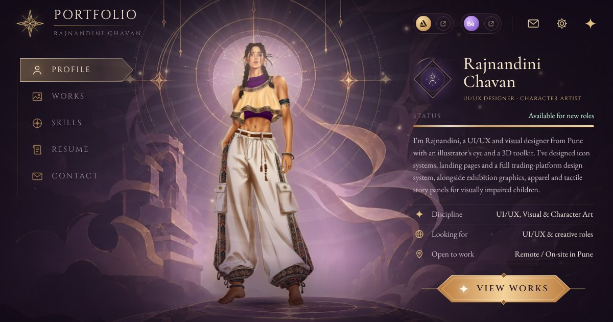

# Rajnandini Chavan | Portfolio

**Live site:** https://ojaseminem.github.io/nancys-portfolio/

The portfolio of Rajnandini Chavan, a character artist and illustrator based in Pune, India. It is designed like a fantasy game character screen. Her character stands on a glowing pedestal, and a gilded menu opens her profile, work, skills, story and contact details.

---

## What visitors see

| Section | What's in it |
| --- | --- |
| **Profile** | Name, role, availability, discipline, focus, medium, location, work mode, and her four disciplines |
| **Works** | Featured artwork with a full-screen viewer, plus links to her full ArtStation and Behance galleries |
| **Skills** | Core skills with levels, and craft strengths |
| **About** | Her story, the roles she is looking for, and location preference (Pune on-site or remote) |
| **Contact** | Email, phone, ArtStation, Behance and location, with one-tap copy buttons |

Visitors on a computer get a short cinematic intro and a mouse parallax effect, where the scene shifts in depth and the character leans toward the cursor. Phones get a touch-friendly layout with a bottom menu. People who prefer less motion can switch the effects off from the ⚙ menu.

Each section has its own link, so you can send someone straight to it:

- https://ojaseminem.github.io/nancys-portfolio/#works
- https://ojaseminem.github.io/nancys-portfolio/#contact

---

## Analytics: who is visiting

The site has visitor analytics built in using **[GoatCounter](https://www.goatcounter.com)**. It is free for personal sites and uses no cookies, so the site does not need a cookie banner. It records visits, not people. No names, emails or IP addresses are stored.

### What gets tracked

**Page views**, one for each section a visitor opens:

| Shows in the dashboard as | Meaning |
| --- | --- |
| `/` | Landed on the Profile |
| `/works` | Opened Works |
| `/skills` | Opened Skills |
| `/about` | Opened About |
| `/contact` | Opened Contact |

**Events**, for the actions that matter when someone is considering hiring her:

| Event | Meaning |
| --- | --- |
| `click-artstation` | Clicked through to ArtStation |
| `click-behance` | Clicked through to Behance |
| `click-email` | Clicked the email link to write to her |
| `click-phone` | Tapped the phone number to call |
| `copy-email` | Copied the email address |
| `copy-phone` | Copied the phone number |
| `view-artwork-…` | Opened an artwork in the full-screen viewer |
| `intro-skipped` | Skipped the intro |
| `setting-motion-off` / `setting-motion-on` | Turned the ambient motion off or on |

Each click event also notes which section it came from. For example, "artstation link (works)" means the ArtStation link inside Works.

**On top of that, GoatCounter automatically shows:**

- **Referrers:** where visitors came from (LinkedIn, ArtStation, Google, an email, etc.)
- **Locations:** country and region
- **Devices:** phone or computer, screen sizes, browsers and operating systems
- **Trends:** visits per day, week or month, and which sections are most popular

### Turning analytics on (one time)

Tracking stays off until a GoatCounter account is connected:

1. Sign up at https://www.goatcounter.com/signup.
2. Choose a **code** for the site, for example `rajnandini`. Your dashboard will live at `https://rajnandini.goatcounter.com`.
3. Send that code to Ojas, who adds it to the site. It is a single line near the top of `index.html`: `<meta name="goatcounter" content="rajnandini" />`.
4. About two minutes after the change, visits start appearing.

### Viewing analytics

Open your dashboard at `https://YOUR-CODE.goatcounter.com` and sign in.

- The **main chart** shows visits over time. Change the date range at the top.
- The **Paths** list shows the sections and events above, with counts. Events are marked with an event label.
- **Referrers, Browsers, Systems, Sizes and Locations** are listed under the chart.
- To share the numbers without sharing your login, you can make the dashboard public in **Settings**, or invite someone as a user.

### Tip: see which job applications bring visitors

Add `?ref=` and a label to the link when you share it somewhere. The label shows up under **Referrers**:

- On LinkedIn: `https://ojaseminem.github.io/nancys-portfolio/?ref=linkedin`
- In an application to a studio: `https://ojaseminem.github.io/nancys-portfolio/?ref=studio-name`
- On a résumé PDF: `https://ojaseminem.github.io/nancys-portfolio/?ref=resume`

That way you can see which applications led someone to actually look at the portfolio.

---

## GitHub traffic (the code page, not the website)

GitHub keeps its own separate numbers for this repository, under **Insights → Traffic**:

- **Views and unique visitors** of the GitHub repository page
- **Clones** of the code
- **Referring sites and popular content** on GitHub

These numbers only cover people looking at the code on GitHub. Visitors to the portfolio website itself are counted in GoatCounter above.

GitHub only keeps 14 days of traffic history, so check it regularly if you want to keep track.

---

## Is the site up to date?

Every change saved to the `main` branch is automatically checked and published. To see the status:

1. Open the **Actions** tab of this repository.
2. The newest run of **Deploy to GitHub Pages** shows a green check when the site is live with the latest changes, or a red cross if something went wrong. In that case the previous version stays online.

A full publish takes about two minutes.

---

## Updating the content

Things that are easy to change:

- New artwork for the Works section (send the image file, a title and a one-line description)
- Profile details, skills, the About text and what roles she is looking for
- Contact details and links
- A résumé PDF download button
- A custom domain such as `rajnandinichavan.com`

Send the changes to Ojas, who maintains the site.

---

## Contact

**Rajnandini Chavan**, Character Artist and Illustrator
Email: rajnandinichavan612@gmail.com
Phone: +91 93737 77294
ArtStation: https://www.artstation.com/rajnandinichavan1
Behance: https://www.behance.net/rajnandchavan1
Pune, India · open to on-site roles in Pune and remote work
